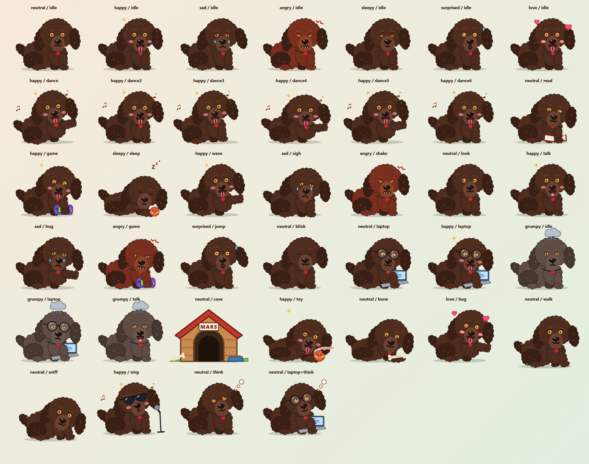

# Mars 🐶

A cartoon **Australian cobberdog** who lives on your Windows desktop (bottom-left until you move Mars). Mars is one year old: soft chocolate-brown curls,
small amber eyes, a slightly longer snout, a red MARS tag and a favourite plush toy, drawn after the real Mars (see `assets/photos/`) in a flat, friendly style
(concept 9 of the concept sheet `docs/concepts/mars-concepts.html`).

Mars has **no window, no frame, no square**: just the dog, sitting on your desktop. Clicks pass straight through everything
except Mars and the speech bubble. Mars starts with Windows and is always there, until you hide Mars.

Sister project of [Sharky](https://github.com/EDS-Eric/Sharky): same engine, a different friend.



## What Mars does

- **Says hello**: good morning, good afternoon, good evening, good night, once per part of the day, not more.
- **Asks how your day was** in the evening, and reacts: dances when it was great, offers a cuddle when it was bad.
- **Shows emotions**: happy (tongue out, panting), sad (ears droop), angry, sleepy, surprised, in love, grumpy. Eyebrows move with every mood. Poke Mars five times in a row and there is growling (with an apology later).
- **Lives a dog's life**: trots around, sniffs the floor, plays with the **plush toy** (*squeak!*), chews a **bone**, does the famous **head tilt**, reads a book, plays a handheld game, chases the tail, dances, sighs.
  Mars does **not** ask for attention: chatter is rare (every 25–55 min), and nothing blocks your work.
- **Copies what you do.** Gaming? Mars games too (with wins and fails). Working in Word, Excel, PowerPoint, Outlook, an editor or the browser? Mars puts on **reading glasses** and types on a laptop. Reading a PDF? Mars reads. No talking while you game; greetings wait. Turn it off in the right-click menu (*Copy what I'm doing*). Only the **process name** of the active app is read, locally; nothing is stored or sent.
- **Howls along with YouTube.** Browser in front while a video (or music) plays? Sunglasses on, nose up to the microphone: *Awoooo ♪*. Only the *playing / not playing* status is read from Windows' media controls, never what is playing.
- **Has mood swings and bad days.** Every day is a good, normal or bad day (about 1 in 5 is bad: the fur goes a bit grey, a little rain cloud). The mood drifts back to that, with an occasional swing. Cheering Mars up works, for a while.
- **Thinks** while the AI writes an answer: head tilt, eyes up, little thought bubbles.
- **Sleeps** from 23:00 to 06:00, lying down with the plush toy. Wake Mars and you hear about the squirrel dream you interrupted.
- **Loves treats**: right-click > *Give Mars a treat*.
- **Talks to you**: double-click Mars for a chat. With an Anthropic API key the answers come from the fastest Claude model
  (**Haiku 5.5**); with a local Ollama model they come from your own PC; without either, Mars answers with simple built-in lines.
- **Remembers your name** (asks once).

## Use Mars

| Do this | Mars does this |
|---|---|
| Click | Woof! / jumps |
| Click 3× fast, 5× fast | Annoyed, then growling |
| Double-click | Opens a chat bubble |
| Drag | Move Mars anywhere on the screen; where you drop Mars becomes the home spot (remembered) |
| Right-click | Menu: chat, how are you, dog fact, dance, treat, copy what I'm doing, learning, quiet mode, language, hide, start with Windows, quit |
| Tray icon (click) | Hide / show Mars: a kennel appears in the nearest bottom corner and Mars trots in, and back out again |

## Install

Requires **Windows 10/11** and **Node.js 20+**.

```
Install-Mars.bat      one-time: installs dependencies, creates .env, starts Mars
Mars.bat              start Mars by hand (Mars also starts at every logon after the first run)
```

or by hand: `npm install` then `npm start`.

On first run Mars is registered under *Start with Windows* (`HKCU\...\Run\Mars`). Turn it off from the tray or right-click menu.

### Optional: give Mars a brain

Copy `.env.example` to `.env` and put your key in it:

```
ANTHROPIC_API_KEY=sk-ant-...
```

The key stays in the main process, never in the page. Cost is tiny: Haiku 5.5, short replies, only when you actually talk to Mars.
**Free and local instead:** install [Ollama](https://ollama.com), run `ollama pull llama3.2` and put `OLLAMA_MODEL=llama3.2` in `.env`. It is used when there is no Anthropic key, and nothing leaves your PC.
No key, no problem: everything else still works.

### Language and quiet mode

Right-click Mars: **Language** (English / Nederlands; defaults to your Windows language) and **Quiet mode** (30 min / 1 hour / 2 hours). In quiet mode Mars does not start any
conversation, but still lives, copies what you do and answers when you talk.

### Mars learns who you are

With a local model (Ollama) Mars also gets to know you, so the chat becomes personal:

- **Habits**: which programs you use most and what you usually do in the morning / afternoon / evening / night. Only program names and time totals; never window titles, never a timeline.
- **What you tell Mars**: "I love cooking", "my sister is called Anna", ... Mars remembers it.

Everything is stored in `%APPDATA%\Mars\memory.json` and goes **only** to your local model, never to Claude or the internet. Right-click Mars: **What do you know about me?**, **Forget everything you learned**, or untick **Learn about me**.

### Troubleshooting

- **I don't see Mars.** Check the tray icon (Mars may be hidden: click it). In an **exclusive-fullscreen game** nothing can be drawn on top; switch the game to *borderless / windowed fullscreen*. `electron . --mars-debug` prints the window state and saves a capture to `%TEMP%\mars_window.png`.
- **Only one Mars runs.** Starting Mars again just shows the one that is already running.
- **Sharky and Mars together?** Yes, they are separate apps and can both live on your desktop.

## Develop

```
npm test               unit tests (node --test): time of day, mood, pokes, AI parsing and fallbacks, dog activities
npm run snapshots      renders every emotion/activity to docs/snapshots.png
npm run icon           regenerates assets/icon.png from the animated picture
```

See [CLAUDE.md](CLAUDE.md) (working notes), [docs/ARCHITECTURE.md](docs/ARCHITECTURE.md), [docs/DECISIONS.md](docs/DECISIONS.md),
[CHANGELOG.md](CHANGELOG.md) and [ROADMAP.md](ROADMAP.md).

## Licence

MIT, see [LICENSE](LICENSE).
